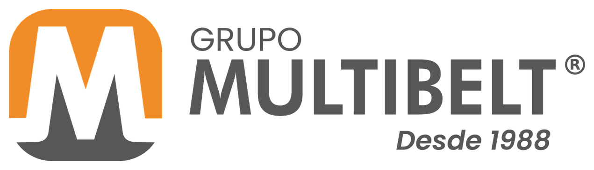

  

# Grupo Multibelt

Indústria e comércio de correias desde 1988, em Ibiporã (PR), com certificação ISO 9001. O grupo reúne **Multibelt**, **Indusbelt** e **Belmaq** e atende agronegócio, indústria e usinas com correias transportadoras, esteiras draper, correias em PVC/PU, correias de borracha e em V, lonas agrícolas e vedações.

Site: [multibelt.com.br](https://multibelt.com.br)

## Projetos

| Repositório | O que é |
|---|---|
| **ada-multibelt** | ADA, a assistente de IA da Multibelt: agentes que consultam o ERP Senior em modo somente leitura, respondem dúvidas de uso do sistema e montam relatórios e painéis interativos |

Os repositórios são privados. O acesso é liberado pela administração da organização.
